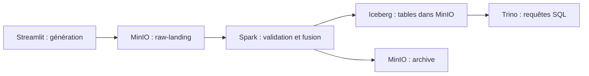

# WABA Lakehouse

Version batch locale du challenge Data Engineer BancAssur Afrique de l'Ouest : niveaux 1 et 2.

Le [périmètre de soumission](docs/submission-status.md) distingue les fonctions vérifiées, adaptations et livrables restants. Les niveaux 3 et 4 sont les étapes suivantes.
La génération des données est séparée de leur ingestion : Streamlit publie des CSV dans MinIO ; Spark traite les fichiers en attente et alimente Iceberg ; Trino interroge les tables.



## Prérequis
Docker Desktop démarré, Docker Compose v2, Python 3 pour initialiser les secrets locaux.
Mac Apple Silicon compatible ; moteur Docker doté d'environ 8 Go de RAM.
Ports locaux : MinIO 9000/9001, Trino 8080, Airflow 8081, Streamlit 8501.

## Démarrage

```sh
python3 bootstrap.py
docker compose up -d --build
docker compose build spark
```

Ouvrir **http://localhost:8501** pour générer les données.
MinIO : http://localhost:9001 ; identifiants dans `.env` (non versionné).
Trino : http://localhost:8080.
Airflow : http://localhost:8081 ; utilisateur et mot de passe dans `.env`. Les DAGs sont initialement en pause pour permettre de charger les référentiels et le scénario avant leur activation.

## Générer un lot
Sélectionner le type de données, la ligne métier disponible pour ce type, un ou plusieurs pays, le nombre de transactions par pays et les dates inclusives.
Choisir le type de données : transactions bancaires, assurance, mobile money, remboursements ou référentiels, puis cliquer sur **Générer et envoyer vers MinIO**. Les référentiels sont créés avant les événements et réutilisés pour les lots suivants. Les valeurs par défaut sont 10 000 lignes bancaires, 5 000 opérations assurance et 20 000 paiements mobile money par pays.
Chaque clic crée un nouveau lot distinct.

Le mode **Continue** propose un intervalle de 10 à 60 secondes et les boutons Démarrer/Arrêter.
Il fonctionne pendant que la session navigateur reste active ; ce n'est pas encore un service autonome.
La génération continue dépose les fichiers ; lorsqu'il est activé, Airflow les traite toutes les 15 minutes.

Chemins des objets :
- `<pays>/references/{customers,accounts,branches,products}.csv`
- `<pays>/<type_de_flux>/<date>/<préfixe>_<pays>_<date>_<lot>.csv`

## Traiter les lots déposés

```sh
docker compose run --rm spark
```

Spark ne génère aucune donnée. Il traite les CSV des quatre flux présents dans raw-landing,
contrôle schéma, devises, valeurs obligatoires et liens entre référentiels, puis fusionne sur la clé propre à chaque flux (transaction_id, operation_id, payment_id ou repayment_id).
Chaque fichier d’événements traité avec succès est copié dans archive puis supprimé du landing. Les lignes valides alimentent Iceberg ; les lignes invalides sont conservées avec leur motif dans `archive/quarantine/<chemin_source>.jsonl`. Un rapport accepté/rejeté est enregistré dans `archive/reports/ingestion/<chemin_source>.json`. Les référentiels sont copiés dans archive et conservés dans le landing pour la génération suivante ; les fichiers inchangés sont ignorés lors des ingestions suivantes.
Un en-tête incompatible, une erreur CSV impossible à parser ou un référentiel invalide fait échouer le job et reste dans le landing. Un fichier d’événements entièrement rejeté est archivé avec zéro ligne acceptée. Les doublons à l’intérieur d’un même fichier sont tous rejetés ; réingérer le même fichier reste idempotent.
Une ingestion sans fichier en attente ne change pas la table.

## Requêtes de contrôle

```sh
docker compose exec trino trino --execute 'SELECT country_code, currency, count(*) AS rows, count(DISTINCT transaction_id) AS unique_ids FROM iceberg.raw.bank_transactions GROUP BY 1, 2'
```

Pour tester une réingestion, remettre une copie d'un fichier archivé dans son chemin d'origine dans raw-landing.
Une nouvelle génération crée un nouveau lot ; elle doit donc augmenter le nombre de transactions.

## Vérifications

```sh
docker compose exec -T app python -m unittest discover -s tests -v
python3 scripts/verify_slice.py
python3 scripts/verify_raw.py
python3 scripts/verify_volume.py
python3 scripts/verify_quarantine.py
```

Les tests d’interface publient de petits lots SN/TG et peuvent régénérer le profil complet dans le MinIO local.
Le contrôle d'intégration traite d'abord les fichiers déjà en attente, publie 25 transactions CI et 25 GH,
les ingère deux fois et vérifie que la réingestion ne crée aucun doublon. Il contrôle également une ingestion sans fichier et un fichier entièrement rejeté.
Ne pas générer d'autres lots pendant cette vérification ; un seul job Spark doit tourner à la fois.
`docs/verification.json` contient le dernier rapport réussi.

## Arrêt

```sh
docker compose stop
```

Les volumes sont conservés. Ne pas utiliser `down -v` pour un arrêt normal.

## Organisation
- `app/main.py` : interface Streamlit.
- `src/waba/generator.py` : génération cohérente et reproductible.
- `src/waba/publisher.py` : publication des référentiels et lots vers MinIO.
- `jobs/ingest_raw.py` : ingestion indépendante des fichiers en attente.
- `infra/` : images et configurations.
- `docs/decisions.md` : hypothèses et limites.
- `scripts/verify_slice.py` : contrôle réel via Spark et Trino.

## Profil complet et contrôle des volumes

Dans Streamlit, sélectionner **Référentiels**, puis **Volumes complets du groupe · les 8 pays**.
Le profil complet couvre toujours les huit pays ; il ne se répète pas en mode continu.
Les référentiels complets existants sont conservés lors de la génération de nouveaux événements.

La même génération est disponible en ligne de commande :

```sh
docker compose run --rm --entrypoint python3 spark /app/jobs/generate_full_references.py
docker compose run --rm spark
python3 scripts/verify_volume.py
```

Pour reproduire le test des volumes de transactions :

```sh
python3 scripts/verify_transaction_volumes.py
```

Ce test ajoute 360 000 événements : 80 000 transactions bancaires, 40 000 opérations assurance,
160 000 paiements mobiles et 80 000 remboursements. Les trois premiers volumes correspondent
aux valeurs par défaut du sujet sur huit pays ; 10 000 remboursements par pays est notre choix de test.
Il rejoue aussi un fichier Ghana de 20 000 paiements pour vérifier l’absence de doublons.
Chaque exécution ajoute un nouveau lot distinct.

Rapports locaux : `docs/volume-verification.json`, `docs/transaction-volume-verification.json`
et `docs/quarantine-verification.json`. Les rapports détaillés par fichier restent dans MinIO.

## Huit tables disponibles

| Table | Contenu | Clé |
| --- | --- | --- |
| raw.customers | Clients des quatre lignes métier | customer_id |
| raw.accounts | Comptes bancaires, polices, wallets et prêts | account_id |
| raw.branches | Agences par ligne métier | branch_id |
| raw.products | Catalogue de démonstration | product_id + country_code |
| raw.bank_transactions | Transactions bancaires | transaction_id |
| raw.insurance_operations | Primes et opérations de sinistre | operation_id |
| raw.mobile_money_payments | Paiements mobiles domestiques | payment_id |
| raw.loan_repayments | Échéances et remboursements de prêts | repayment_id |

Toutes les tables contiennent country_code et entity_type. Partitionnement par pays et date d’événement pour les flux, date d’ingestion pour les référentiels.
`verify_raw.py` teste la présence des huit tables et deux ingestions des quatre flux CI/GH ; le rapport réussi est dans `docs/raw-verification.json`.

## État et limites
Les quatre flux et les huit tables ont été validés avec les référentiels complets et un lot de 360 000 événements sur les huit pays.
Les tests du générateur couvrent les huit pays, les relations entre les données, les plages de dates et les identifiants UUIDv4 reproductibles. Les premiers lots historiques avaient des UUIDv5 et restent conservés.
Les tests d’interface couvrent la génération ponctuelle, le mode continu et les nouveaux types de données.
Les volumes cibles sont générés et validés via Trino : **500 000 clients, 800 000 comptes, 200 agences et 50 produits au total**, répartis sur huit pays, avec des clés uniques et aucun compte sans client. Les lignes de démonstration initiales sont conservées. Le générateur échantillonne les grands référentiels lorsqu’ils existent.
Le générateur aléatoire de base produit des paiements domestiques ; le scénario niveau 2 ajoute des corridors UEMOA transfrontaliers.
Les opérations aléatoires sans contexte comptable restent exclues des ratios assurance. Le scénario niveau 2 ajoute les couvertures, primes acquises et sinistres liés ; les exclusions sont comptées dans une table dédiée.
Le portefeuille NPL du scénario utilise des prêts MICROFINANCE et des photographies d’encours explicites. Les portefeuilles de prêts BANK et les jours fériés nationaux restent à enrichir.
Les références sont produites et publiées fichier par fichier. Spark télécharge les CSV sur un disque temporaire et conserve ses intermédiaires sur disque. Ce chemin est adapté au mode local[2] actuel ; des exécuteurs Spark répartis nécessiteront un accès direct partagé au stockage objet.
Les rejets par ligne sont disponibles. Les erreurs de structure irrécupérables et les référentiels invalides restent bloquants.
Le catalogue REST Apache est une fixture de développement avec SQLite persistant, pas une configuration de production.
MinIO est construit depuis une version source précise car ses anciennes images publiques ne sont plus accessibles.


## Niveau 2 : Bronze, Silver, Gold et Airflow

Le [modèle métier](docs/level2-design.md) détaille les formules, sources comptables simulées, limites et règles de backfill. Les huit tables raw restent conservées ; Bronze et Silver sont des tables physiques distinctes. Sept indicateurs Gold sont accessibles dans la page **Indicateurs** de Streamlit.

Avant le premier pipeline de niveau 2, créer les référentiels complets puis publier le scénario cohérent (février 2026 par défaut) :

```sh
docker compose run --rm --entrypoint python3 spark /app/jobs/generate_full_references.py
docker compose run --rm --entrypoint python3 spark /app/jobs/seed_demo.py
```

Cette commande initialise les quatre flux, même sur un environnement vierge, et ajoute une petite activité bancaire/mobile aux huit pays. Le scénario crée des encours, des primes avec couverture comptable, des sinistres liés et des transferts transfrontaliers. Réexécuter sa publication conserve les mêmes IDs. Pour un autre mois : `docker compose run --rm -e SCENARIO_MONTH=2026-03-01 --entrypoint python3 spark /app/jobs/seed_business_context.py`.

Dans Airflow, activer les quatre DAGs, puis déclencher `dag_ingest_raw`. Il lance automatiquement Bronze → Silver → Gold. L'ingestion est ensuite planifiée toutes les 15 minutes ; le reporting quotidien est planifié à 00h30 UTC. Une configuration de lancement sélectif :

```json
{"country_codes": ["CI"], "date_from": "2026-02-01", "date_to": "2026-02-28"}
```

Le DAG `dag_regulatory_report` accepte `report_date` ; pour rejouer le reporting de la démo, utiliser `2026-02-28`. Les fichiers sont dans `archive/regulatory/2026-02-28/<pays>/`. Ils constituent des agrégats de démonstration, pas les formulaires officiels BCEAO/CIMA.

Alternative pour exécuter les mêmes jobs sans attendre le scheduler :

```sh
python3 scripts/run_pipeline.py --report-date 2026-02-28
python3 scripts/run_pipeline.py --countries CI --date-from 2026-02-01 --date-to 2026-02-28 --report-date 2026-02-28
```

Le service de soumission sérialise ses jobs Spark. Pendant ces contrôles, laisser `dag_ingest_raw` en pause ; les anciennes commandes `docker compose run spark` lancent un conteneur séparé et ne partagent pas ce verrou.

Contrôles reproductibles (après un premier chargement complet) :

```sh
python3 scripts/verify_level2.py
python3 scripts/verify_airflow.py
python3 scripts/verify_backfill.py
```

`verify_airflow.py` active les DAGs et teste leurs exécutions réelles, puis remet l'ingestion périodique en pause pour permettre un test isolé. Réactiver `dag_ingest_raw` dans l'interface pour reprendre le traitement automatique. `verify_backfill.py` rejoue CI/février, compare les empreintes des sept tables Gold et contrôle un reporting à mi-mois. Les rapports sont dans `docs/level2-verification.json`, `docs/airflow-verification.json` et `docs/backfill-verification.json`.

Les taux FX sont simulés et datés ; les événements d'assurance historiques sans contexte comptable sont exclus des ratios et comptés dans `gold.insurance_accounting_coverage`. Les intérêts non renseignés sont signalés dans le revenu par client. Les limites métier et le décalage GN/UEMOA du sujet sont documentés dans le modèle.

La base et les journaux Airflow persistent dans des volumes. L'orchestrateur local utilise SequentialExecutor/SQLite ; le profil Kubernetes devra utiliser PostgreSQL et Spark Operator.

## Tests automatiques du dépôt
GitHub Actions exécute les tests déterministes et les tests avec stockage simulé. Les validations Docker/Spark/Trino et les cinq tests Streamlit utilisent la stack locale et ne sont pas présentés comme exécutés dans cette CI.


## Documents pour la revue
- [Explication des encours et des primes acquises](docs/business-explanation.md).
- [Write-up technique : architecture, règles et limites](docs/level2-design.md).
- [État de conformité et preuves](docs/submission-status.md).
- [Déroulé de démonstration de 5 à 10 minutes](docs/demo-script.md) ; vidéo à enregistrer.

Les secrets se créent avec `python3 bootstrap.py` ; ne pas versionner `.env`. Pour un dépôt privé, partager explicitement l'accès avec les évaluateurs avant de transmettre le lien.
