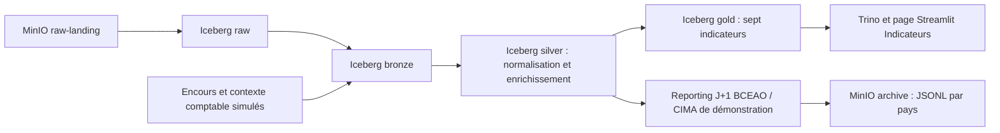

# Niveau 2 — modèle métier et pipeline batch

## Architecture et exécution

Les huit tables historiques `raw.*` restent disponibles. Bronze est une copie physique distincte, dédupliquée par clé métier et pays, partitionnée par pays et date d'ingestion. Silver conserve les événements, joint les clients, comptes, agences et produits pertinents, convertit les montants en décimaux et en EUR, et distingue les informations comptables renseignées des opérations historiques non modélisées. Gold agrège ces résultats par pays, entité, jour ou mois.

Quatre DAGs Airflow : `dag_ingest_raw` lance l'ingestion puis Bronze ; il déclenche `dag_bronze_to_silver`, qui déclenche `dag_silver_to_gold`. `dag_regulatory_report` est planifié à **00h30 UTC chaque jour** et utilise le jour précédent. L'ingestion est planifiée toutes les 15 minutes lorsqu'elle est activée. Deux retries espacés de 30 secondes sont configurés. Une erreur produit un événement JSON `pipeline_failure` dans les journaux Airflow ; un webhook peut être configuré explicitement dans la Variable `waba_alert_webhook`. Aucun webhook n'est activé par défaut.

La version locale utilise **Airflow 2.10.5, SQLite et SequentialExecutor**. Un pool Spark d'un slot et un verrou du service de soumission empêchent deux JVM Spark simultanées dans le service. Le service n'expose ni le socket Docker du Mac ni un port vers l'hôte. Il accepte seulement cinq noms de jobs, valide les paramètres et authentifie les requêtes par un jeton privé. Les mots de passe et le jeton sont créés dans `.env`, hors Git. L'adresse et le jeton du service sont fournis à Airflow via des Variables d'environnement.

Ces choix visent une démo reproductible avec 18 Go de RAM, dont environ 8 Go alloués à Docker. En déploiement distribué : PostgreSQL pour Airflow, Spark Operator pour les jobs, stockage objet partagé pour la lecture CSV et Secrets Kubernetes.

## Données nécessaires et hypothèses déclarées

Les remboursements seuls ne donnent pas l'encours d'un portefeuille. Les primes encaissées ne suffisent pas à connaître les primes acquises. On ajoute donc deux **sources simulées explicites**, chargées en Bronze, sans modifier les clients/comptes existants :

- `loan_positions` : photographie de 100 prêts par pays à la fin du mois, avec encours, jours d'impayé et indicateur de défaut. Une exposition identique de 1 000 EUR par prêt rend les cibles contrôlables ; le calcul Gold utilise néanmoins les encours pondérés.
- `accounting_context` : rattachement aux identifiants des nouvelles opérations ; intérêts reçus, couverture des primes, identifiant de sinistre et dates de soumission/paiement.

Le scénario reproductible de février 2026 crée 800 positions, 800 remboursements, 2 400 opérations d'assurance et 120 paiements transfrontaliers. Les 100 polices par pays couvrent exactement le mois : primes acquises linéairement sur cette couverture. Chaque sinistre est soumis puis payé après dix jours ouvrés. Les intérêts simulés constituent 10 % d'une échéance payée ; les échéances en défaut ne produisent aucun intérêt reçu. Ces paramètres sont des hypothèses pédagogiques, pas une calibration de marché.

| Pays | NPL cible du scénario | Ratio sinistres / primes cible |
|---|---:|---:|
| CI | 3 % | 50 % |
| SN | 4 % | 55 % |
| ML | 5 % | 60 % |
| BF | 6 % | 65 % |
| GN | 7 % | 70 % |
| TG | 8 % | 75 % |
| BJ | 4 % | 80 % |
| GH | 5 % | 85 % |

La conversion utilise **655,957 XOF/EUR et 12,5 GHS/EUR**, des valeurs configurées pour le scénario, avec une validité explicite sur 2026 et `fx_source = SIMULATED_CONFIG`. Aucun taux GHS courant n'est revendiqué. Une date sans taux applicable bloque la transformation plutôt que d'utiliser un taux implicite. Une intégration réelle doit charger une table FX quotidienne sourcée et historisée.

Le sujet classe GN dans sa convention XOF/UEMOA. Nous conservons XOF pour GN dans les données afin de respecter son contrat, mais **GN n'est pas membre de l'UEMOA** : les corridors UEMOA et le périmètre BCEAO/CIMA de cette démo utilisent CI, SN, ML, BF, TG et BJ. Les agrégats GN/GH restent visibles avec une indication hors périmètre. Les périmètres sont confirmés par les listes officielles de la [BCEAO](https://www.bceao.int/fr/etats-membres/) et de la [CIMA](https://cima-afrique.org/les-etats-membres/). Les seuils de 5 % et 70 % sont repris comme **seuils du challenge**, sans prétendre valider une norme réglementaire actuelle.

## Définitions des indicateurs

| Table Gold | Calcul et dénominateur |
|---|---|
| `daily_transaction_volume` | Nombre de tentatives, nombre et montant des transactions bancaires SUCCESS, par jour/pays/entité/type ; montants FAILED/REVERSED exclus du total économique. |
| `npl_ratio_by_country` | Encours en défaut ou avec au moins 90 jours d'impayé / encours total de la photographie, par pays/type de prêt/date. Aucun ratio d'échéances impayées n'est utilisé à la place du NPL. |
| `customer_arpu_monthly` | Commissions bancaires effectivement perçues + intérêts documentés des remboursements, divisés par le nombre de clients distincts ayant une activité observée dans le mois et l'entité. Les intérêts absents sont signalés par `unknown_interest_events` ; le résultat ne prétend pas couvrir tous les revenus d'un établissement. |
| `loss_ratio_by_product` | Sinistres effectivement payés / primes acquises, par mois/pays/catalogue produit/ligne d'assurance. Les événements sans contexte comptable sont exclus et comptés dans `insurance_accounting_coverage`. |
| `claims_processing_time` | Moyenne des jours ouvrés entre soumission et paiement des sinistres payés, par pays/mois/IARD ou Vie. Weekends exclus, jours fériés non fournis. |
| `mobile_money_daily_flow` | Tentatives, succès, montant des succès, échecs / toutes les tentatives, utilisateurs actifs distincts parmi expéditeurs et destinataires de paiements réussis. Chaque utilisateur est rattaché à son pays. |
| `cross_border_transfers` | Succès entre deux pays UEMOA distincts, regroupés par corridor et semaine ISO ; volume, montant, moyenne, variation avec la semaine précédente uniquement si elle est consécutive. La ligne appartient au pays expéditeur ; filtrer `receiver_country` donne les flux entrants. |

Le catalogue initial contient un produit générique par activité. Les cinq lignes assurance restent distinguées dans `product_line`, jointes au produit `INSURANCE-STANDARD` du référentiel ; aucune nouvelle clé produit orpheline n'est inventée.

## Rejeu, backfill et reporting

Les paramètres `country_codes`, `date_from`, `date_to` limitent les événements à traiter. Les référentiels nécessaires à une jointure transfrontalière sont disponibles pour tous les pays ; les copies Bronze/Silver n'écrivent que les pays sélectionnés. Les MERGE utilisent clé métier + pays, et les positions prêt ajoutent la date de photographie. Gold recalcule **tout l'historique des pays sélectionnés**, même lors d'un backfill d'un mois, afin de préserver les dénominateurs mensuels complets. Son remplacement atomique conserve tous les autres pays. Les jobs ne suppriment aucun référentiel ni volume Docker.

Le reporting `report_date = D` utilise la dernière photographie de prêt **au plus tard D** et les sinistres payés jusqu'à D. Les primes du mois sont acquises au prorata des jours de couverture écoulés ; aucune prime du mois complet n'est reconnue par anticipation au milieu du mois. Les tables `regulatory_bceao_daily` et `regulatory_cima_daily` et les fichiers `archive/regulatory/D/pays/*.jsonl` sont des **agrégats de démonstration**, pas les formulaires officiels de déclaration. Un jour sans photographie antérieure n'invente pas d'encours. Une photographie ancienne reste datée explicitement et demande, en exploitation réelle, un contrôle de fraîcheur.

L'idempotence se vérifie sur les valeurs métier, et pas seulement sur un nombre de lignes : un rejeu CI/février compare les empreintes des sept tables Gold avant/après et vérifie la conservation des autres pays. Les validations Trino confrontent aussi les ratios aux paramètres du générateur, le total bancaire au total SUCCESS de Silver, les délais au calendrier et les chemins physiques distincts des trois couches.

## Références techniques

- [Airflow 2.10.5 : déploiement Docker et extension d'image](https://airflow.apache.org/docs/apache-airflow/2.10.5/howto/docker-compose/index.html)
- [Airflow : sémantique des DAG runs et intervalles de données](https://airflow.apache.org/docs/apache-airflow/2.10.5/core-concepts/dag-run.html)
- [Iceberg 1.9.1 : MERGE et écritures Spark](https://iceberg.apache.org/docs/1.9.1/spark-writes/)
